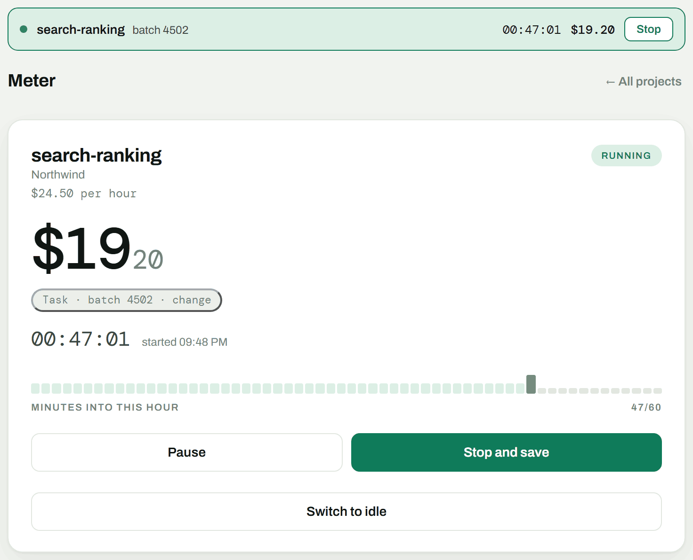
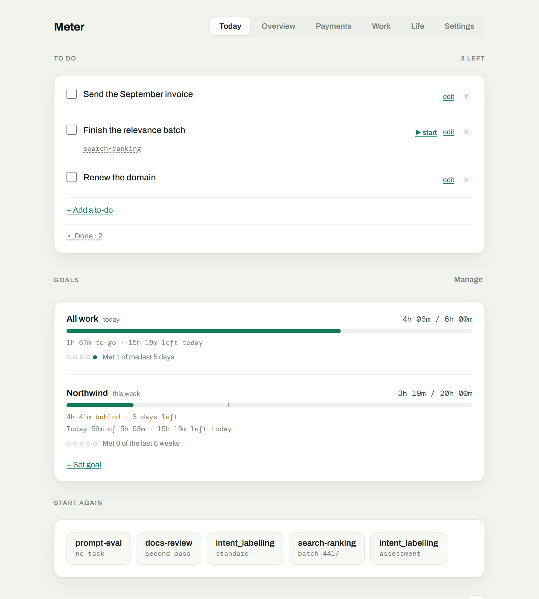
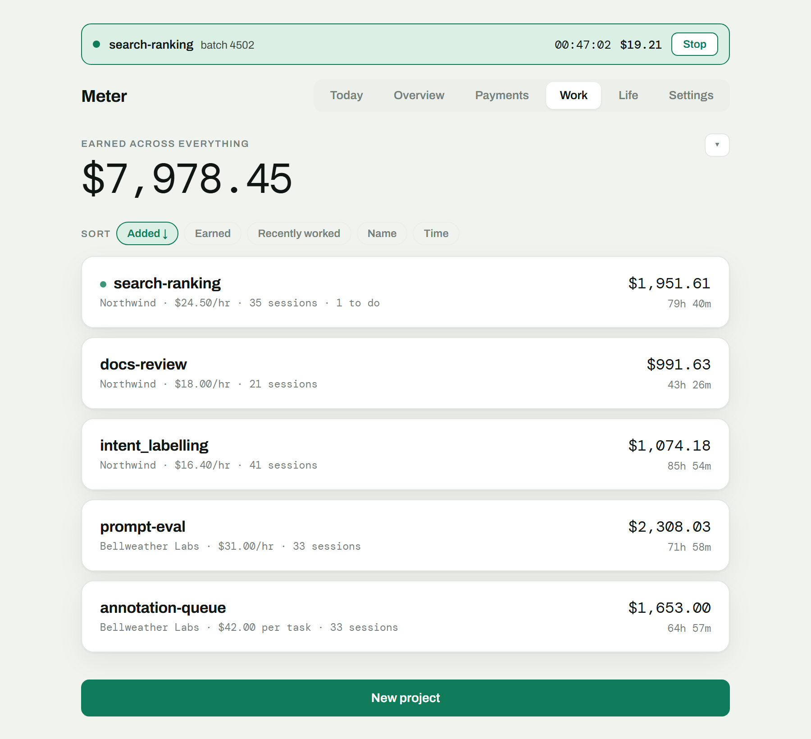
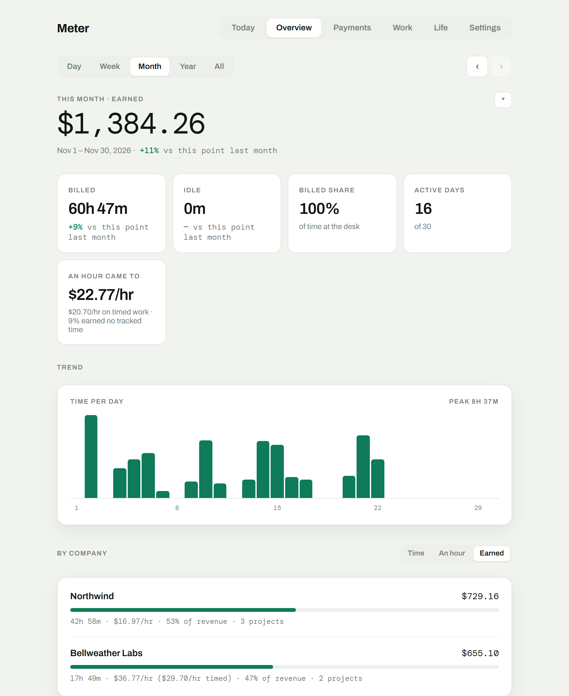
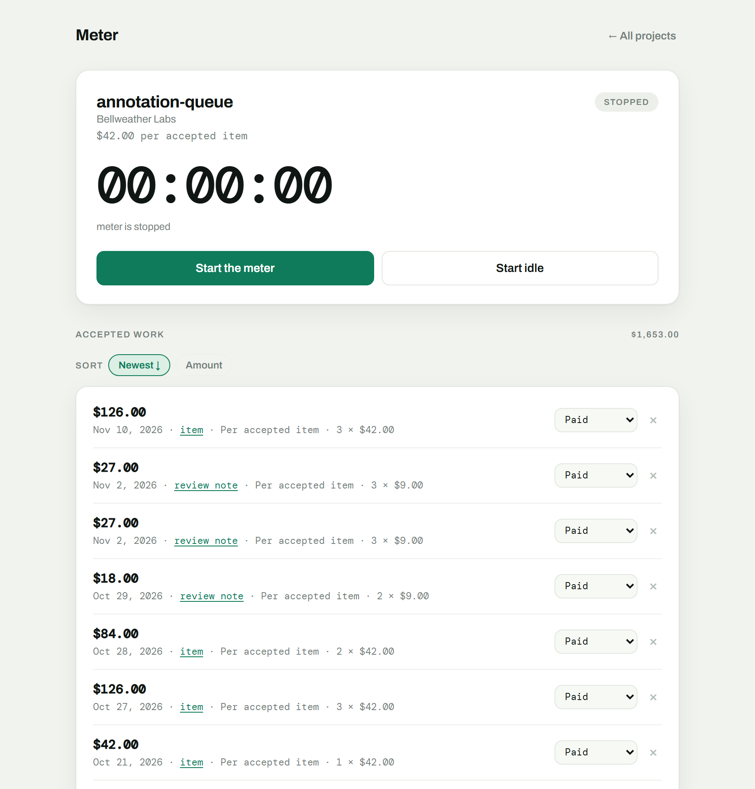
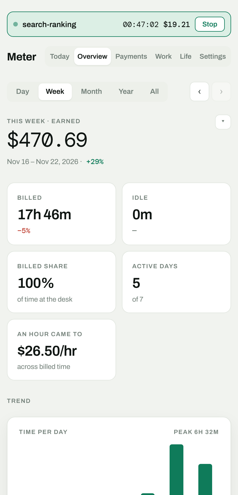
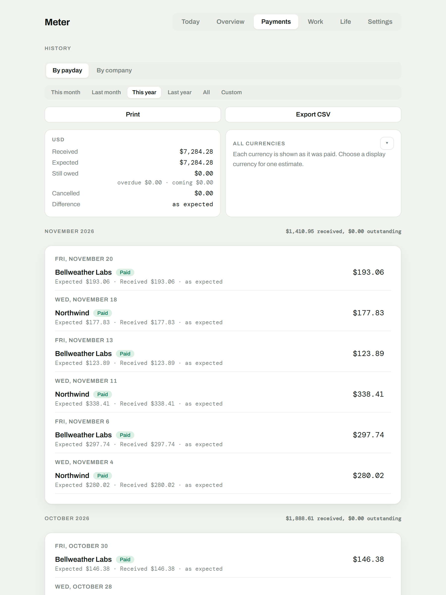

# Meter

**An hourly earnings meter.** Start a timer against a project, watch the money
accrue in real time, and keep an honest ledger of every session.

[](https://github.com/Ahmed41022/meter/actions/workflows/ci.yml)
[](https://github.com/Ahmed41022/meter/actions/workflows/pages.yml)
[](LICENSE)

### [→ Try it in your browser](https://ahmed41022.github.io/meter/)

Nothing to install, no account, no server. Your data stays in your browser
unless you switch on sync — and Meter Sync encrypts it on your device first,
so the relay it passes through, which you can run yourself, never sees a
project, a client or an amount.





| Every project at once | A month, across all of them |
| --- | --- |
|  |  |

| Paid per item, not per hour | On a phone |
| --- | --- |
|  |  |

**What each client paid, payday by payday**



<sub>Screenshots run against `docs/demo-seed.json` — invented projects, invented
rates. `npm run shots` regenerates every one of them.</sub>

---

## What it does

- **Opens on Today**: a to-do list, what you have done today, every day there
  was work, and a one-click restart of the last few things you ran.
- **Times a session against a project** and shows the money as it accrues —
  from wherever you are in the app, not just the project you started on.
- **Runs one meter at a time, except where that is wrong.** A project whose
  clock ticks while something else does the waiting can allow parallel tasks:
  they run side by side and beside other projects, and whatever is not your
  main task is marked as working in background. A life activity runs beside
  any work.
- **Snapshots the rate onto the session**, so changing a project's rate
  reaches back only as far as you say: from now on, which leaves work already
  handed in alone, or the whole project, past included.
- **Knows a task's time limit** where a platform sets one: past it, the time
  pays the share the platform pays — 30%, or nothing — and the meter counts
  down the full-rate time that is left.
- **Knows a task's minimum time** where one is required: its clock counts down
  over every sitting until it is met.
- **Keeps a daily goal** for all your work together, in hours or in money.
- **Prices work four ways**, and a project can move between the first two
  whenever its platform does: by the hour, per accepted item, a task at its own
  rate, or a task at a fraction of the project's. A task can also be priced at
  nothing, which is not the same as having no price set.
- **Asks what a sitting produced** when the work is paid on acceptance rather
  than by the hour, and files it as pending until you are actually paid.
- **Reports any day, week, month, year or all of it** across every project at
  once — hours, earnings, what an hour actually came to, and how much of your
  income comes from one client.
- **Records money the clock never measured** — bonuses, piece rates, rewards —
  so the ledger matches what you were actually paid.
- **Tracks pending, paid and cancelled**, because work finished is not money
  received.
- **Says which task has been paid for** and which is still only done — and
  settles a batch of them in one go, since approval never arrives one task at
  a time: handed in, then accepted or rejected, with the money following the
  answer. One reward can cover fifty tasks without pretending to be a price
  per task.
- **Says when the money lands.** Each client gets a payday — weekly or
  monthly, cut off at the minute and on the clock the client states it in —
  and Upcoming payments lists what arrives on which day, task by task: work
  paid as worked from the day it was handed in, work paid once accepted from
  its answer, and work still under review only as the earliest it could arrive.
  A task's hours, per-item pay, bonuses and adjustments are lines of their own,
  and a bonus tied to no task rides the next payday after the day you add it.
  Once a payday passes, Meter asks what happened: paid in full, cancelled, or
  not yet or only partly received. What actually came is recorded, so $101
  against an expected $100 is a dollar more in your earnings. When a client
  pays only some of a payday, tick those lines and mark them paid, or move
  the rest to another day.
- **Runs on a phone** as an installed app, offline, and syncs with your other
  devices through **Meter Sync**: end-to-end encrypted, through a relay on a
  free Cloudflare account, with live updates — including stopping, from
  whichever device is to hand, a meter the other one started. Pair a device with
  a QR code; a recovery code gets the account back. Google Drive sync still
  works for now and is being replaced.
- **Keeps the history of what was paid.** The Payments tab holds Upcoming
  payments and, below it, every payday by date or by company, back to the
  first day of the ledger: work from before paydays were set up is dated by
  the client's schedule as it stood then. It shows what was expected, what
  came, and what is still owed, overdue and coming, per currency and never
  added across them. A deduction comes off the payday it belongs to, so each
  figure is what actually lands. Print it as a statement or export it as a CSV.
- **Follows your system's light or dark setting**, or whichever you pick,
  from the Settings tab, which also lists every client's payday, holds
  backup, restore and sync, and sets the order each project list opens in.
- **Shows totals in one currency, if you want** — optionally. Turn on live
  exchange rates in Settings → Currency (off by default; only a public rates
  file is fetched, nothing from your ledger) and a ▾ beside each total picks a
  display currency from your favourites. Converted figures are marked ≈ with
  the rate date; the default stays each currency as earned, never added.
- **Exports** a JSON backup or a CSV of every line item, and a payment
  statement as a printout or a CSV.

The full tour, with examples of every panel, is in **[FEATURES.md](FEATURES.md)**.

---

## How it's built

Three decisions do most of the work, and each one exists to prevent a specific
wrong number:

- **Elapsed time is derived, never accumulated.** A session stores `startedAt`
  and computes `now - startedAt` on read. Browsers throttle background tabs to
  about one tick a minute and a sleeping machine stops ticking entirely — so a
  counter would quietly lose most of every session.
- **Money is derived from time, never stored.** No total is ever cached,
  because deleting a session would immediately make a cached total lie.
- **Time is an argument, never ambient.** No function in `src/domain` calls
  `Date.now()`; the caller passes `now`. That single constraint is what makes
  the whole rules layer testable without mocking a clock.

The reasoning behind every other decision — soft deletes, segments rather than
start/end pairs, crash recovery, idle time, task rate overrides, schema
evolution without version numbers — is in **[ARCHITECTURE.md](ARCHITECTURE.md)**.

**Stack:** React 18, esbuild, Vitest. Two runtime dependencies. No framework,
no state library, no CSS framework.

---

## Tested

Every rule in the domain layer is tested without a browser, and the
integration tests drive the *built* file in jsdom rather than the source, so
what ships is what was tested.

Coverage floors are enforced in CI — 85% lines, functions and statements, 80%
branches — over `src/domain` and `src/storage`. The suite runs on both Linux
and Windows, because it has twice been green on one and red on the other.

```bash
npm run check      # lint, build, then test
npm run coverage   # with the thresholds enforced
```

More on what is and isn't tested, and why: [ARCHITECTURE.md](ARCHITECTURE.md#testing).

---

## Getting started

Meter needs **Node 24** (`.nvmrc` says 24; `engines` asks for 22.13 or later),
because the relay's tests run on Node's built-in `node:sqlite`. The app itself
runs in a browser and needs no Node.

```bash
npm install
npm run build      # produces dist/meter.html
npm test
```

| Script | What it does |
| --- | --- |
| `npm run build` | Bundle into a single `dist/meter.html` |
| `npm test` | Run all tests |
| `npm run coverage` | Tests with coverage thresholds enforced |
| `npm run lint` | ESLint |
| `npm run check` | Lint, build, then test — what CI runs |
| `npm run icons` | Regenerate the icon set from `scripts/make-icons.py` |
| `npm run shots` | Recapture the README's screenshots and GIF |
| `npm run desktop` | Package a standalone Windows `.exe` |
| `npm run relay:deploy` | Deploy your own sync relay to Cloudflare, in one command |
| `npm run relay:admin -- <command>` | Invites, accounts, caps and open sign-up on your relay |
| `npm run relay:local` | Run the relay on `127.0.0.1:8788` for development, with no Cloudflare account |

`npm run build` must run before `npm test`, because the integration suite drives the built file rather than the source.

---

## Operating your own relay

Meter Sync goes through a **relay**: one Cloudflare Worker and two small
SQLite-backed Durable Objects, in `relay/`, which fit on a free Cloudflare
account. It stores ciphertext it cannot read. The built-in relay at
`https://meter-sync.ahmedsaad41022.workers.dev` is invite-only and run as
"Meter Sync"; if you would rather hold your own, deploy another and point a
device at it with **Use my own relay** in Settings → Sync & backup.

```bash
npm run relay:deploy                         # first deploy, and any redeploy
npm run relay:admin -- invite --label "me"   # an invite code and link for one account
npm run relay:admin -- stats                 # accounts, sizes, devices, last seen: never content
```

`relay:deploy` signs in to Cloudflare in your browser if it must, makes the
relay's two secrets into the git-ignored `relay/.admin.json` (never printed:
keep a copy in a password manager), deploys, and checks that it answers. Run it
again to redeploy with the same secrets. Never `relay:init --force` on a relay
that holds accounts: new secrets orphan every one of them. The full guide, with
the caps, open sign-up and the Cloudflare notes, is in
**[relay/README.md](relay/README.md)**; how it works and what it can see is in
[ARCHITECTURE.md](ARCHITECTURE.md#sync).

---

## Running it

**Just open it.** `dist/meter.html` works by double-clicking. Everything is inlined — React, styles, icons.

**As a desktop app.** Run `tools/Setup Meter.bat` from a folder containing `meter.html` and `meter.ico`. It creates a Desktop shortcut that launches Edge or Chrome in `--app` mode with its own `--user-data-dir`, so you get a separate process, its own taskbar entry, and no browser chrome.

**As a real executable.** `npm run desktop` packages a standalone `Meter.exe` — its own process, its own taskbar entry, no browser involved. It opens the hosted app, so it updates itself from every deploy like a phone does, and keeps it for working offline; on its first launch it carries what the bundled copy held across, once. The shell in `desktop/` is more than a wrapper:

- its title bar is the app's own colour, with the window's buttons drawn over the page, and F11 is real full screen
- it remembers window size and position between launches
- a second launch focuses the existing window instead of starting a rival process that would fight over the same storage
- closing with a meter still running asks first, since that is exactly how a session ends up billing overnight

That guard reads persisted state directly, because the Electron main process can't import the app's ES modules. The duplicated rule lives in `desktop/running.js` with its own tests — nothing else would notice if it drifted from the domain. Any doubt (corrupt storage, a failed read) resolves to "not running", so a broken guard can never trap you inside the app.

The cost is real: about 220 MB on disk to run a 300 KB file, because it ships its own copy of Chromium. That copy also stops receiving security patches when the pinned Electron does. The shortcut above gets you the same standalone window using the engine Windows already keeps updated, which is why it's listed first.

Note that Edge and Chrome grey out "Install as an app" for `file://` pages, since installation requires a secure origin. That's why the shortcut route exists.

---

## Versioning

Meter follows semantic versioning, with the version tied to the one
compatibility boundary that actually matters here — **the stored ledger**:

| Bump | Means |
| --- | --- |
| **Major** | The stored shape changed such that an older build can no longer read it. |
| **Minor** | A feature. New fields land here safely, because an absent field always has a defined meaning. |
| **Patch** | A fix that stores nothing new. |

Releases are tagged `vX.Y.Z` and carry a built `meter.html` and a packaged
Windows desktop app. See [CHANGELOG.md](CHANGELOG.md).

---

## Known gaps

- **Corrections replace, they don't accumulate.** `original` holds what the meter recorded, and that's it — there's no log of each successive edit or when. Enough to prove a figure was adjusted; not a full audit trail.
- **No re-filing or repricing history.** A session doesn't record that it was moved between tasks, and a task doesn't record that its rate changed or when.
- **No archiving.** A task leaves the start prompt once it is handed in, but the task list keeps every task, finished or not. Delete is the only way to take one off it, and that unfiles its sessions.
- **No cross-project task view.** Tasks belong to one project, so a task number spanning two projects reports as two separate tasks.
- **No billing increments.** Time is billed to the second. If you invoice in 15-minute blocks, the ledger and your invoice will disagree.
- **No way yet to remove another device from a Meter Sync account**, and no screen to restore an account from the recovery code on a fresh install. Until then a lost device is cut off by deleting the account, and the JSON backup is the fallback if every device is lost. Devices that sync should run the same version.
- **No cross-tab locking.** Two tabs are detected and warned about, but not prevented.
- **Idle time isn't in goals.** Deliberate — a money goal fed by unbilled time is meaningless. If it belongs in goals later, the right shape is a utilisation target, not a second money target.
- **Fonts load from Google Fonts.** First run with no internet falls back to system faces. Layout is unaffected.

---

## License

MIT — see [LICENSE](LICENSE).
